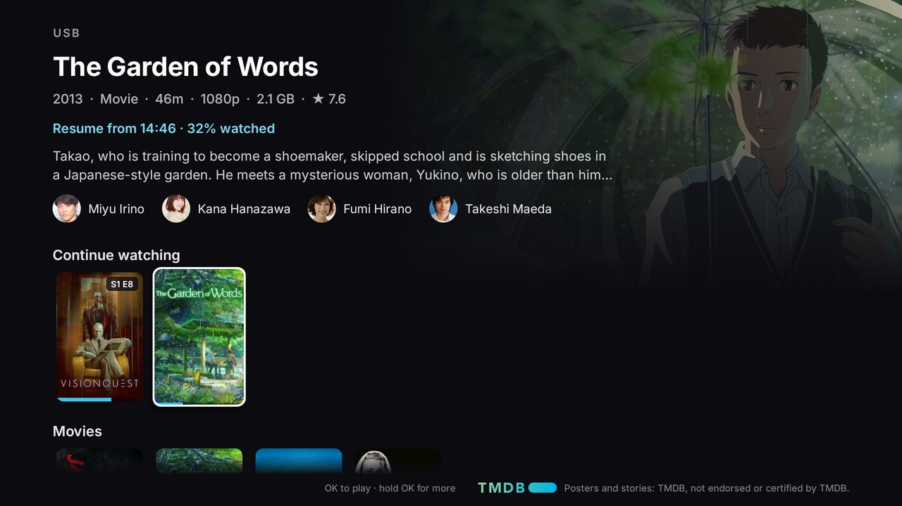
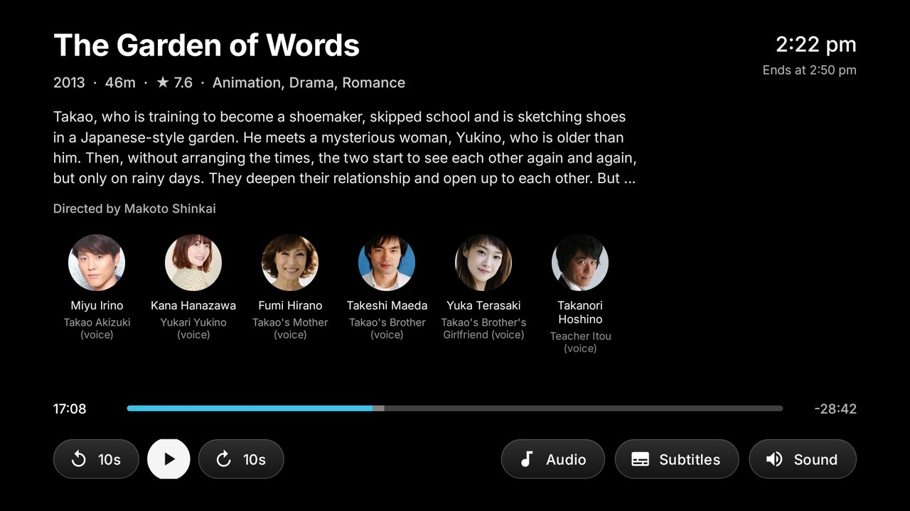
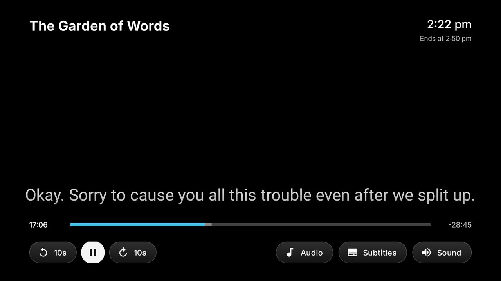
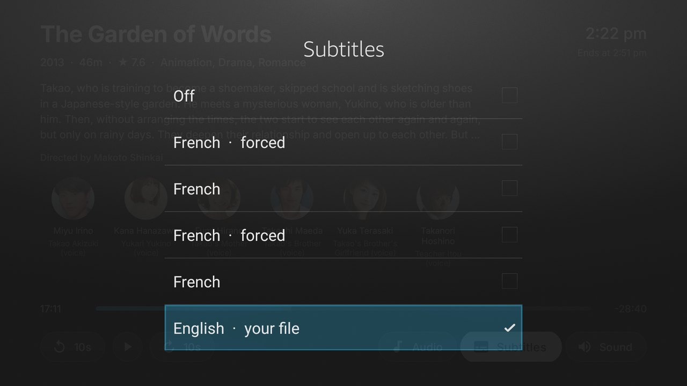

# fire-tv-cleanup

**Your TV, minus the ads.** Debloat an Android TV, Google TV or Fire TV over ADB and give it a
clean launcher with a macOS-style dock. Hand the prompt to Claude Code or any coding assistant,
answer a few questions about which apps you use, and it does the rest on the real TV.

Forked from [Gathin23/tv-vibehack](https://github.com/Gathin23/tv-vibehack), which covers Android TV
and Google TV. This fork adds Fire TV support and the launcher features listed below.


Everything is reversible: packages are disabled, never uninstalled, and a restore script puts the
stock launcher back.

## Quick start

1. On the TV: Settings → Device Preferences → About → press OK on **Build** seven times → back →
   Developer options → turn on **USB debugging** (and Network/ADB debugging if your TV shows it).
   Keep the TV on and on the same Wi-Fi as your computer.
2. Open Claude Code (or your assistant of choice) on your computer and paste the prompt from
   [`PROMPT.md`](PROMPT.md), filling in your TV model.
3. Accept the "Allow USB debugging?" prompt on the TV when told to, then answer the checklist
   questions (which apps you use, which four go in the dock).

That's it. The assistant backs up, debloats, builds and installs the launcher, and verifies each
step with screenshots from the TV. If you'd rather do it by hand, the pieces are below.

## What's in the repo

| Path | What it is |
|---|---|
| [`PROMPT.md`](PROMPT.md) | The prompt. Brand-neutral; the assistant discovers your TV's bloat. |
| [`launcher/`](launcher/) | The tvOS-style launcher. Edit `app/src/main/res/values/config.xml` for your dock, hidden apps and Live TV package, then run `build-and-install.sh`. |
| [`tools/tv.py`](tools/tv.py) | Pure-Python ADB client (shell, batch, push, pull). Works where the stock `adb` is blocked. |
| [`tools/b64push.py`](tools/b64push.py) | Uploads larger files (APKs) as base64 chunks with an md5 check. |
| [`tools/disable.sh`](tools/disable.sh), [`tools/restore.sh`](tools/restore.sh) | Apply or undo a debloat list. |
| [`examples/`](examples/) | Per-TV debloat lists. Add yours, see [CONTRIBUTING.md](CONTRIBUTING.md). |

## The launcher

A small native Android TV home screen (`com.gathin.tvhome`), built for sets with 1 GB of RAM:

- A full-screen photo with a daytime and a night version. The greeting follows the time of day ("Good evening, Alex"). Add your own pictures to rotate every
  30 minutes: see [Your own wallpapers](#your-own-wallpapers).
- Only the dock is frosted glass, a live blur of the photo behind it; the rest of the photo
  stays sharp.
- A macOS-style dock of up to four apps with square icons. The focused icon grows and lifts, its
  neighbours grow a little, and a capsule label shows its name. Press Down for the rest of your
  apps.
- Pin, unpin and reorder dock apps on the TV: hold OK or press Menu on an app.
- Round buttons top right: **Inputs** (HDMI ports, AV and Live TV), **Wi-Fi** (signal bars, plus a
  warning when there is no internet) and **Settings**. Greeting, clock and date top left, set in
  [Inter](https://rsms.me/inter/).
- Hold OK on the Settings button for **Tools**: sleep timer, headphone boost, turn off or restart
  the TV, Bluetooth, developer options, and free memory and storage at a glance.
- A screensaver of the same photos with a slow zoom, a crossfade every 20 seconds and a clock.

Configure it in [`launcher/app/src/main/res/values/config.xml`](launcher/app/src/main/res/values/config.xml):
the starting dock, hidden apps, Live TV package and columns. To put your name in the greeting, add
`tvhome.userName=Alex` to `launcher/local.properties`. The YouTube, Netflix, Prime Video and AirPlay
dock icons are trademarked logos, so they are not in the repo. Draw them locally with
[`tools/make_dock_icons.py`](tools/make_dock_icons.py). Apps without one show their own icon.
Build and install with

```bash
TV_HOST=192.168.1.50 launcher/build-and-install.sh
```

Needs JDK 17 and the Android SDK (platform 34, build-tools 34.0.0). On macOS:
`brew install openjdk@17 android-commandlinetools && sdkmanager "platforms;android-34" "build-tools;34.0.0"`.

### Trending, USB and Live News

Three optional screens, each a tile on the home screen.

- **Trending**: movies and series trending this week, and what's popular on Netflix, Prime Video,
  Apple TV+ and JioHotstar, with where to watch each in India (TMDB and JustWatch data), its
  trailer, and Stremio links.
- **USB**: films and series on a USB drive, with posters, stories and cast photos from TMDB.
  - **Rows:** Continue watching (with the next episode after a finished one), Movies, and Series
    (one tile per show).
  - **Auto-open:** plugging in a drive while the home screen is showing opens it.
  - **Its own player** (ExoPlayer, the engine in Just Player):
    - Plays each title in its **original language** (from TMDB) with **English subtitles**:
      SDH first, then a subtitle file beside the video, then a full English track.
    - **Remembers** where you stopped, and the tracks you pick for each file.
    - **TV-style controls:** title, clock and end time; Audio and Subtitles menus that name every
      track ("Japanese · 5.1 · AAC", "English · SDH").
    - A **pause screen** with the story, director and cast.
    - Sound: a **boost** up to 200% (separately for the speakers and headphones) and a **voice
      boost** for quiet dialogue.
    - Plays tunneled (the TV paces the frames) whenever no sound effect is on.
    - Hold OK on a title to open it in Just Player or VLC instead.
- **Live News** (red button): YouTube news channels you add on the TV by pasting a link or a
  handle. Opening one lists every stream it has live right now.

| USB screen | Pause screen |
|---|---|
|  |  |
| **Player controls** (with the English subtitle file beside the video) | **Subtitles menu** |
|  |  |

Screenshots from a Fire TV Edition 4K TV; the picture is black because Android doesn't capture video in screenshots.

Trending and the USB screen's posters need a free [TMDB](https://www.themoviedb.org/settings/api)
**API Read Access Token**. Add it to `launcher/local.properties`:

```properties
tvhome.tmdbToken=eyJhbGciOi...
```

Without one, the USB screen still lists and plays your files, with names taken from the file names.
`local.properties` is git-ignored: keep your token out of commits, and don't share an APK built with
it. On the TV the USB screen needs storage access, which `build-and-install.sh` grants
(`pm grant com.gathin.tvhome android.permission.READ_EXTERNAL_STORAGE`; undo with `pm revoke`).

### Your own wallpapers

Pictures in `/sdcard/Android/media/com.gathin.tvhome/wallpapers/` join the rotation after the
built-in photo, one every 30 minutes, in name order. The folder needs no permission:

```bash
adb push 01-sunset.jpg /sdcard/Android/media/com.gathin.tvhome/wallpapers/
```

An optional `captions.txt` there names them under the top-right buttons, one
`file<TAB>name` per line. Use pictures you're allowed to use: many studios share wallpapers for
personal use only. Keep those out of this repo (`wallpapers/` is git-ignored).

To use your own built-in photo and names on your TV only, put `bg_morning.jpg`,
`bg_afternoon.jpg`, `bg_evening.jpg` and `bg_night.jpg` in `launcher/app/src/release/res/drawable-nodpi/`
and your strings (`builtin_caption_day`, `builtin_caption_night`, `screensaver_label`) in
`launcher/app/src/release/res/values/`. Release builds use them instead of the defaults, and
that folder is git-ignored.

## Talking to the TV by hand

```bash
python3 -m venv tools/venv && tools/venv/bin/pip install -r tools/requirements.txt
export TV_HOST=192.168.1.50                                   # your TV's IP
tools/venv/bin/python -I tools/tv.py --probe                 # model, Android version, firmware
tools/venv/bin/python -I tools/tv.py 'pm list packages'      # one command
printf 'cmd1\ncmd2\n' | tools/venv/bin/python -I tools/tv.py --batch
tools/disable.sh examples/xiaomi-mi-tv-4a/debloat.txt        # apply a list
tools/restore.sh examples/xiaomi-mi-tv-4a/debloat.txt        # undo it, restore stock launcher
```

### Gotchas we hit

- **macOS: `adb connect` says "No route to host"** while the port is clearly open. Recent macOS
  treats the Google-signed `adb` as its own app under Local Network privacy and silently blocks it.
  `tools/tv.py` avoids the binary entirely.
- **No "wireless debugging" toggle** on some TVs (Xiaomi among them). USB debugging alone opens
  network ADB on port 5555.
- **Chained `pm` commands** (`pm disable a; pm disable b`) may silently stop after the first. Run
  one per shell call; `--batch` does this.
- **Large pushes hang** through the Python client. Use `tools/b64push.py` for APKs.
- **Disable the stock launcher only after the new one is installed**, or the Home button lands on
  a factory test app.
- **Third-party launchers** often charge for basics like a custom wallpaper. Hence `launcher/`.
- **No on-screen keyboard** after switching launchers (seen on Xiaomi): the default input method
  pointed at a Baidu IME that isn't installed. Fix with
  `tools/tv.py 'ime set com.google.android.inputmethod.latin/com.android.inputmethod.latin.LatinIME'`.

## Fire TV

Fire OS is Android underneath, but it guards its home screen. Tested on a Hisense Fire TV Edition
(Fire OS 8, Android 11, model AFTOLCBC82).


To set it up:

1. On the TV, open **Settings → Device & Software → About**, select the device name seven times,
   then go back to **Developer Options** and turn on **ADB debugging**.
2. Run `TV_HOST=<tv ip> launcher/build-and-install.sh`. On Fire TV it installs the launcher, turns
   on its Home redirect and sets its screensaver. It leaves Amazon's launcher alone.
3. Optional: disable the ad and telemetry packages with
   `tools/disable.sh examples/hisense-fire-tv-AFTOLCBC82/debloat.txt`.

How it differs from Android TV:

- **Amazon's launcher stays.** Fire OS ignores the default-home setting, and Amazon's launcher also
  hosts Settings. Disabling it locks you out of Settings. The launcher's `HomeRedirectService`
  opens the launcher whenever Amazon's home screen comes up, so Amazon's screen shows for a moment
  before yours.
- **Settings keeps working.** Amazon's home screen also flashes up on the way into Settings, right
  after a window from Amazon's settings app. The redirect leaves that flash alone.
- **To turn the redirect off on the TV,** press Menu on the launcher's Settings button and choose
  **Use Amazon Home Screen**.
- **ADB turns off when the TV restarts.** Turn **ADB debugging** back on in Developer Options
  before you connect again.
- **Some packages are protected.** Fire OS refuses to disable the four packages listed in the
  example debloat list. Undo the rest with `tools/restore.sh` and the same list.
- **AirPlay has no screen of its own.** The AirPlay tile opens nothing, and casting from an iPhone
  works anyway.
- **Picture settings can't be opened by an app.** Fire OS keeps Picture, Display & Sounds and the
  quick-settings panel to Amazon's own apps. Hold **Home** for the panel, then **Picture** (Filmmaker
  Mode, Backlight). It works over a playing film too.
- **Appstore updates can turn a disabled app back on.** Re-run the debloat list now and then.
- **No 24 Hz output on built-in-TV models.** These TVs offer apps a single 60 Hz mode, so no player
  can switch the refresh rate. The USB player tells the TV each film's frame rate and plays
  tunneled, so the TV's own film processing paces the frames.

Also tested on a Fire TV Edition 4K TV (Fire OS 8.1, Android 11, model AFTNE4E43F).

## Supported TVs

Android TV and Google TV: Xiaomi/Redmi, TCL, Hisense, Sony, OnePlus, Realme, Nvidia Shield and most
others. Fire TV: see [Fire TV](#fire-tv). Not Samsung Tizen or LG webOS. Tested so far on the models
in [`examples/`](examples/).

## Contributing

Add your TV's debloat list, improve the launcher, or sharpen the prompt. See
[CONTRIBUTING.md](CONTRIBUTING.md).

## Licence

MIT, see [`LICENSE`](LICENSE). The Outfit and Open Sans typefaces are under the SIL Open Font
License, see `launcher/FONT-LICENSE-OFL.txt`. Photo credits are in [`CREDITS.md`](CREDITS.md).
